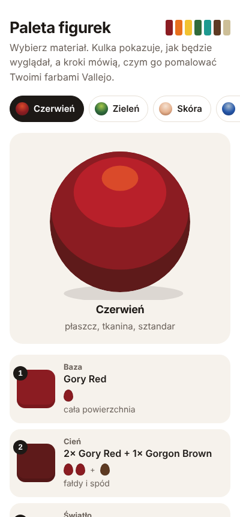

# Paleta figurek

Pomocnik do malowania figurek z druku 3D, z farbami Vallejo. Działa w przeglądarce i jako aplikacja na Androida, bez internetu.

<p>



</p>

## Co potrafi

| Zakładka | Funkcje |
| --- | --- |
| **Przepisy** | Materiały (czerwień, skóra, złoto, stal, drewno…) w czterech odcieniach: cień, baza, światło, błysk, z kroplami do mieszania. Brakująca farba dostaje zamiennik. Podstawki: pustynia, ziemia, bruk, lawa, śnieg, bagno, trawa. |
| **Figurki** | 12 instrukcji (m.in. Artur Morgan, rycerz, ork, smok) z odhaczaniem kroków, tryb przy stole z dużymi literami, własne figurki, kolejka „do pomalowania / w trakcie / gotowe”, galeria zdjęć przed i po. |
| **Narzędzia** | Moje farby (z „kończy się”), zamienniki Citadel → Vallejo, minutnik schnięcia z powiadomieniami, kalkulator rozcieńczania i mieszania, kolory ze zdjęcia, plan kolorów z generatorem zestawów, kopia zapasowa, panel szafki lakierniczej i lampy na ESP32. |
| **Wiedza** | Koło barw, cień i światło bez szarości, zasada 60/30/10, techniki w obrazkach, słowniczek pojęć. |
| **Druk 3D** | Ustawienia Bambu Lab A1 mini dla dyszy 0,4 i 0,2 mm, kalkulator skali, przygotowanie wydruku FDM, zenithal, mokra paleta, typowe błędy. |
| **Zakupy** | Lista z oznaczeniami produktów, „kończy się” i kopiowanie do Google Keep. |

## Instalacja na Androidzie

1. Pobierz [`apk/PaletaFigurek-1.4.1.apk`](apk/PaletaFigurek-1.4.1.apk).
2. Otwórz plik na telefonie i zezwól na instalację z nieznanych źródeł.
3. Przy pierwszym uruchomieniu zezwól na powiadomienia (minutnik schnięcia).

Wymaga Androida 8.0 lub nowszego.

## W przeglądarce

Całość to jeden plik [`index.html`](index.html). Otwórz go w przeglądarce albo włącz GitHub Pages dla tego repozytorium.

## Budowanie APK

Aplikacja to `index.html` w WebView z małą warstwą natywną w smali (wybór zdjęć, powiadomienia przez `AlarmManager`).

```bash
cd android
mkdir tools   # apktool.jar 2.10.0 i uber-apk-signer.jar 1.3.0
./build.sh
```

## Warsztat (ESP32)

Panel w zakładce Narzędzia → Warsztat łączy się z ESP32 w sieci domowej:

- `GET /data` → `{"t":21.5,"h":48}` (temperatura °C, wilgotność %)
- `GET /lamp?k=4000&b=80` → barwa 3000–6500 K, jasność 0–100%

Odpowiedzi z nagłówkiem `Access-Control-Allow-Origin: *`.
